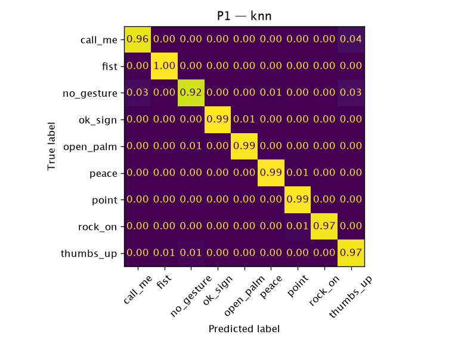

# P1 — `knn`

**Question:** Does the model generalize to people it never saw?

- Train: HaGRID train subjects
- Test: HaGRID test subjects
- Date: 2026-10-12
- Reproduce: `uv run python -m ml.eval --protocol p1 --model knn`

## Datasets

| Dataset | SHA-256 | Records used (raw) | Duplicates removed |
|---|---|---:|---:|
| `hagrid_landmarks_v1` (`ml/data/hagrid_landmarks_v1/records.jsonl`) | `d5db335e537d…` | 12485 (12495) | 10 |

## Results

2497 test samples, 1309 independent groups (bootstrap unit). Trained on 8362 samples from 6753 subjects.

| Metric | Value | 95 % CI |
|---|---:|---|
| accuracy | 0.976 | [0.970, 0.982] |
| macro_f1 | 0.976 | [0.970, 0.982] |

### Per class

| Class | Precision | Recall | F1 | Support |
|---|---:|---:|---:|---:|
| `call_me` | 0.963 | 0.960 | 0.962 | 274 |
| `fist` | 0.982 | 0.996 | 0.989 | 272 |
| `no_gesture` | 0.974 | 0.924 | 0.948 | 288 |
| `ok_sign` | 0.989 | 0.993 | 0.991 | 282 |
| `open_palm` | 0.989 | 0.986 | 0.988 | 284 |
| `peace` | 0.989 | 0.993 | 0.991 | 279 |
| `point` | 0.978 | 0.989 | 0.984 | 272 |
| `rock_on` | 0.996 | 0.975 | 0.985 | 275 |
| `thumbs_up` | 0.926 | 0.974 | 0.950 | 271 |

Accuracy by handedness — Left: 0.969, Right: 0.982.

### By demographic group

HaGRID meta, automatically estimated (FairFace / MiVOLO), so approximate. Groups under 100 samples are marked *.

| Attribute | Group | Accuracy | n |
|---|---|---:|---:|
| gender | female | 0.981 | 1348 |
| gender | male | 0.970 | 1149 |
| race | Asian* | 0.990 | 98 |
| race | Black | 0.980 | 205 |
| race | Indian* | 0.986 | 72 |
| race | White | 0.979 | 1984 |
| race | unknown | 0.920 | 138 |
| age | 0-9* | 1.000 | 4 |
| age | 10-19 | 0.983 | 359 |
| age | 20-29 | 0.976 | 837 |
| age | 30-39 | 0.969 | 777 |
| age | 40-49 | 0.981 | 376 |
| age | 50-59 | 0.982 | 114 |
| age | 60+* | 1.000 | 30 |

Inference: 0.024 ms/sample (Python, not in-browser). Fit time: 0.0 s.
