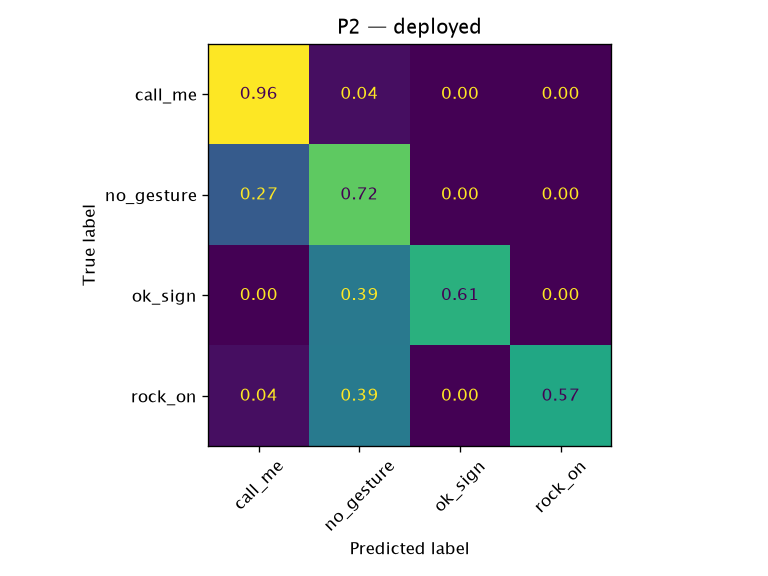

# P2 — `deployed`

**Question:** Does the deployed model, trained on one person's hand, work on thousands of others?

- Train: none — deployed weights (author's own recordings, gestures_v1)
- Test: HaGRID test subjects
- Date: 2026-10-12
- Reproduce: `uv run python -m ml.eval --protocol p2 --model deployed`

## Datasets

| Dataset | SHA-256 | Records used (raw) | Duplicates removed |
|---|---|---:|---:|
| `hagrid_landmarks_v1` (`ml/data/hagrid_landmarks_v1/records.jsonl`) | `d5db335e537d…` | 12485 (12495) | 10 |

## Results

2497 test samples, 1309 independent groups (bootstrap unit). Pre-trained model: nothing fitted in this run.

| Metric | Value | 95 % CI |
|---|---:|---|
| accuracy | 0.719 | [0.702, 0.736] |
| macro_f1 | 0.694 | [0.673, 0.714] |

### Per class

| Class | Precision | Recall | F1 | Support |
|---|---:|---:|---:|---:|
| `call_me` | 0.360 | 0.960 | 0.524 | 274 |
| `no_gesture` | 0.841 | 0.723 | 0.778 | 1666 |
| `ok_sign` | 0.961 | 0.610 | 0.746 | 282 |
| `rock_on` | 1.000 | 0.571 | 0.727 | 275 |

Accuracy by handedness — Left: 0.716, Right: 0.722.

### By demographic group

HaGRID meta, automatically estimated (FairFace / MiVOLO), so approximate. Groups under 100 samples are marked *.

| Attribute | Group | Accuracy | n |
|---|---|---:|---:|
| gender | female | 0.708 | 1348 |
| gender | male | 0.732 | 1149 |
| race | Asian* | 0.694 | 98 |
| race | Black | 0.820 | 205 |
| race | Indian* | 0.819 | 72 |
| race | White | 0.739 | 1984 |
| race | unknown | 0.246 | 138 |
| age | 0-9* | 0.500 | 4 |
| age | 10-19 | 0.713 | 359 |
| age | 20-29 | 0.706 | 837 |
| age | 30-39 | 0.712 | 777 |
| age | 40-49 | 0.769 | 376 |
| age | 50-59 | 0.719 | 114 |
| age | 60+* | 0.767 | 30 |

Inference: 0.0006 ms/sample (Python, not in-browser). Fit time: 0.0 s.
