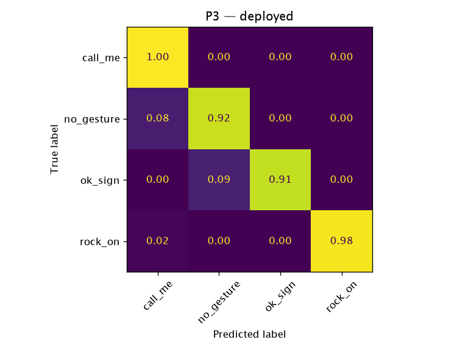

# P3 — `deployed`

**Question:** Does a model learned from HaGRID photos work on live webcam video in the app?

- Train: none — deployed weights (author's own recordings, gestures_v1)
- Test: own_v2 (live webcam)
- Date: 2026-10-12
- Reproduce: `uv run python -m ml.eval --protocol p3 --model deployed`

## Datasets

| Dataset | SHA-256 | Records used (raw) | Duplicates removed |
|---|---|---:|---:|
| `hagrid_landmarks_v1` (`ml/data/hagrid_landmarks_v1/records.jsonl`) | `d5db335e537d…` | 12485 (12495) | 10 |
| `own_v2` (`ml/data/own_v2.json`) | `fe1abff90fc9…` | 2400 (2400) | 0 |

## Results

2400 test samples, 81 independent groups (bootstrap unit). Pre-trained model: nothing fitted in this run.

| Metric | Value | 95 % CI |
|---|---:|---|
| accuracy | 0.935 | [0.889, 0.973] |
| macro_f1 | 0.923 | [0.853, 0.969] |

### Per class

| Class | Precision | Recall | F1 | Support |
|---|---:|---:|---:|---:|
| `call_me` | 0.662 | 1.000 | 0.796 | 260 |
| `no_gesture` | 0.984 | 0.920 | 0.951 | 1620 |
| `ok_sign` | 1.000 | 0.908 | 0.952 | 260 |
| `rock_on` | 1.000 | 0.985 | 0.992 | 260 |

Accuracy by handedness — Left: 0.902, Right: 0.963.

Inference: 0.0006 ms/sample (Python, not in-browser). Fit time: 0.0 s.
