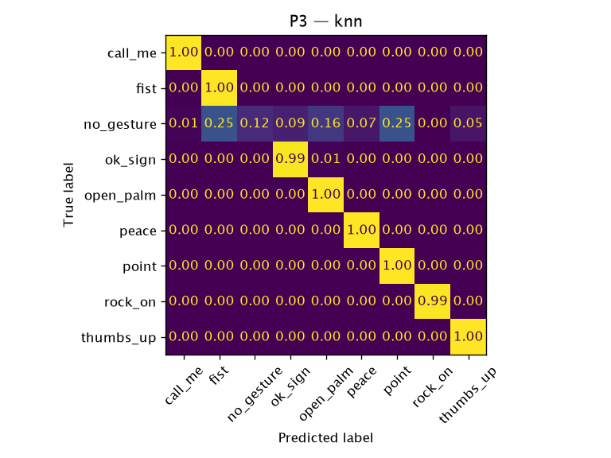

# P3 — `knn`

**Question:** Does a model learned from HaGRID photos work on live webcam video in the app?

- Train: HaGRID train subjects
- Test: own_v2 (live webcam)
- Date: 2026-10-12
- Reproduce: `uv run python -m ml.eval --protocol p3 --model knn`

## Datasets

| Dataset | SHA-256 | Records used (raw) | Duplicates removed |
|---|---|---:|---:|
| `hagrid_landmarks_v1` (`ml/data/hagrid_landmarks_v1/records.jsonl`) | `d5db335e537d…` | 12485 (12495) | 10 |
| `own_v2` (`ml/data/own_v2.json`) | `fe1abff90fc9…` | 2400 (2400) | 0 |

## Results

2400 test samples, 81 independent groups (bootstrap unit). Trained on 8362 samples from 6753 subjects.

| Metric | Value | 95 % CI |
|---|---:|---|
| accuracy | 0.880 | [0.809, 0.937] |
| macro_f1 | 0.857 | [0.794, 0.896] |

### Per class

| Class | Precision | Recall | F1 | Support |
|---|---:|---:|---:|---:|
| `call_me` | 0.989 | 1.000 | 0.994 | 260 |
| `fist` | 0.762 | 0.996 | 0.863 | 260 |
| `no_gesture` | 1.000 | 0.122 | 0.217 | 320 |
| `ok_sign` | 0.899 | 0.988 | 0.941 | 260 |
| `open_palm` | 0.825 | 1.000 | 0.904 | 260 |
| `peace` | 0.925 | 1.000 | 0.961 | 260 |
| `point` | 0.762 | 1.000 | 0.865 | 260 |
| `rock_on` | 1.000 | 0.992 | 0.996 | 260 |
| `thumbs_up` | 0.939 | 1.000 | 0.968 | 260 |

Accuracy by handedness — Left: 0.892, Right: 0.871.

Inference: 0.0255 ms/sample (Python, not in-browser). Fit time: 0.0 s.
