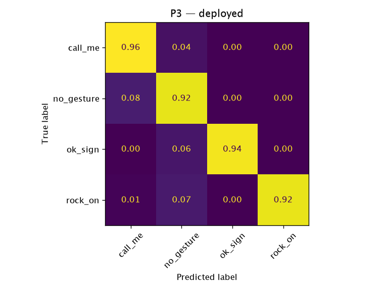

# P3 — `deployed`

**Question:** Does a model learned from HaGRID photos work on live webcam video in the app?

- Train: none — deployed weights (author's own recordings, gestures_v1)
- Test: own_v2 (live webcam)
- Date: 2026-10-13
- Reproduce: `uv run python -m ml.eval --protocol p3 --model deployed`

## Datasets

| Dataset | SHA-256 | Records used (raw) | Duplicates removed |
|---|---|---:|---:|
| `hagrid_landmarks_v1` (`ml/data/hagrid_landmarks_v1/records.jsonl`) | `d5db335e537d…` | 12485 (12495) | 10 |
| `own_v2` (`ml/data/own_v2.json`) | `86b72fad77f7…` | 4680 (4680) | 0 |

## Results

4680 test samples, 136 independent groups (bootstrap unit). Pre-trained model: nothing fitted in this run.

| Metric | Value | 95 % CI |
|---|---:|---|
| accuracy | 0.928 | [0.893, 0.960] |
| macro_f1 | 0.909 | [0.855, 0.951] |

### Per class

| Class | Precision | Recall | F1 | Support |
|---|---:|---:|---:|---:|
| `call_me` | 0.633 | 0.957 | 0.762 | 460 |
| `no_gesture` | 0.974 | 0.922 | 0.947 | 3260 |
| `ok_sign` | 1.000 | 0.941 | 0.970 | 460 |
| `rock_on` | 0.994 | 0.924 | 0.958 | 500 |

Accuracy by handedness — Left: 0.904, Right: 0.953.

### By recording session

| Session | Lighting | n | Accuracy | Gestures only | `no_gesture` recall |
|---|---|---:|---:|---:|---:|
| `2026-10-12-svl1` | artificial | 2400 | 0.935 | 0.964 | 0.920 |
| `2026-10-13-s8lv` | daylight | 2280 | 0.920 | 0.911 | 0.924 |

Inference: 0.0012 ms/sample (Python, not in-browser). Fit time: 0.0 s.
