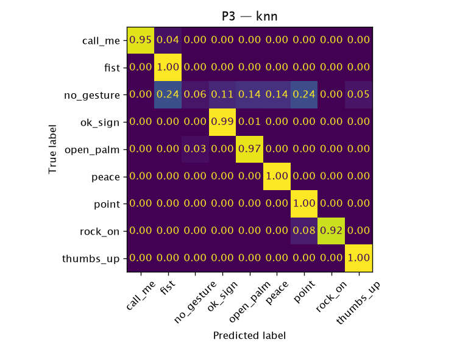

# P3 — `knn`

**Question:** Does a model learned from HaGRID photos work on live webcam video in the app?

- Train: HaGRID train subjects
- Test: own_v2 (live webcam)
- Date: 2026-10-13
- Reproduce: `uv run python -m ml.eval --protocol p3 --model knn`

## Datasets

| Dataset | SHA-256 | Records used (raw) | Duplicates removed |
|---|---|---:|---:|
| `hagrid_landmarks_v1` (`ml/data/hagrid_landmarks_v1/records.jsonl`) | `d5db335e537d…` | 12485 (12495) | 10 |
| `own_v2` (`ml/data/own_v2.json`) | `86b72fad77f7…` | 4680 (4680) | 0 |

## Results

4680 test samples, 136 independent groups (bootstrap unit). Trained on 8362 samples from 6753 subjects.

| Metric | Value | 95 % CI |
|---|---:|---|
| accuracy | 0.850 | [0.795, 0.899] |
| macro_f1 | 0.822 | [0.777, 0.854] |

### Per class

| Class | Precision | Recall | F1 | Support |
|---|---:|---:|---:|---:|
| `call_me` | 0.993 | 0.952 | 0.972 | 460 |
| `fist` | 0.716 | 0.998 | 0.834 | 460 |
| `no_gesture` | 0.732 | 0.062 | 0.115 | 660 |
| `ok_sign` | 0.859 | 0.993 | 0.921 | 460 |
| `open_palm` | 0.821 | 0.967 | 0.888 | 460 |
| `peace` | 0.842 | 1.000 | 0.914 | 500 |
| `point` | 0.701 | 1.000 | 0.824 | 460 |
| `rock_on` | 1.000 | 0.920 | 0.958 | 500 |
| `thumbs_up` | 0.950 | 1.000 | 0.974 | 720 |

Accuracy by handedness — Left: 0.868, Right: 0.831.

### By recording session

| Session | Lighting | n | Accuracy | Gestures only | `no_gesture` recall |
|---|---|---:|---:|---:|---:|
| `2026-10-12-svl1` | artificial | 2400 | 0.880 | 0.997 | 0.122 |
| `2026-10-13-s8lv` | daylight | 2280 | 0.819 | 0.961 | 0.006 |

Inference: 0.0438 ms/sample (Python, not in-browser). Fit time: 0.01 s.
